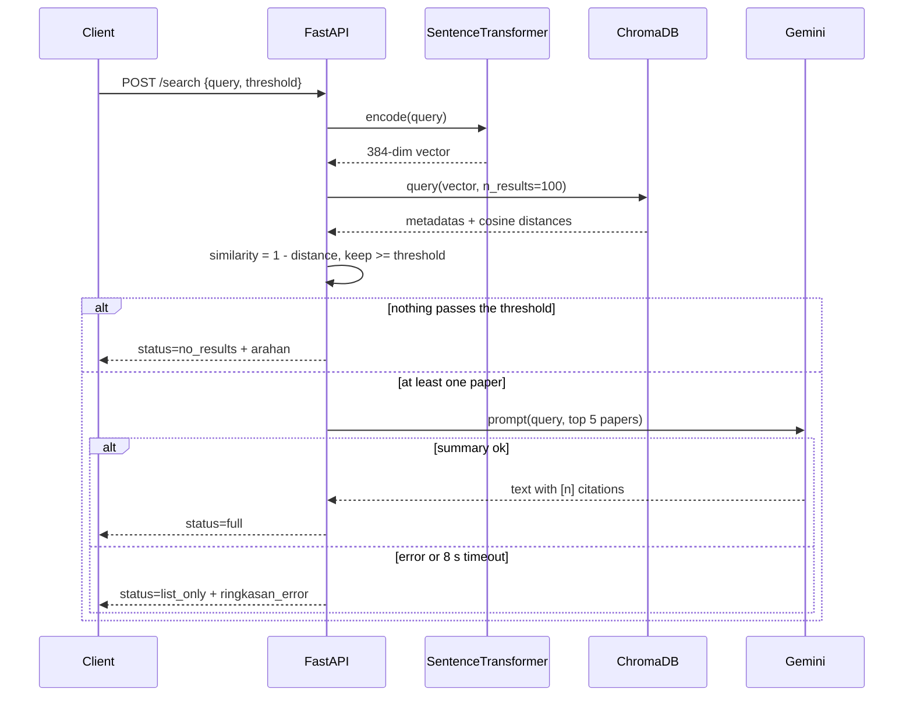

# Undip Research Semantic Search API

A small FastAPI service that answers free-text questions over ~1,000 harvested
Universitas Diponegoro eprints. It embeds the query, searches a local ChromaDB
collection by cosine similarity, returns the matching papers, and — when a
Gemini key is configured — adds an AI summary whose claims are cited against the
papers that were actually retrieved.

> **Status: prototype.** Built for a project demo, not a production deployment.
> See [Known limitations](#known-limitations) before relying on it.

## How it works



The service never fails a search because the LLM failed: the worst case is
`status=list_only`, which still returns the ranked papers.

## Quick start (local)

**Prerequisites**

- Python 3.11+
- The vector database in `./eprints_vector_db` — **the app refuses to start
  without it**. See [docs/DATA.md](docs/DATA.md) for how to build it.
- `GEMINI_API_KEY` and `GEMINI_MODEL` in `.env` (optional; without them the API
  still works and returns `status=list_only`).

```bash
cp .env.example .env                      # fill in both Gemini values
pip install -r requirements.txt
uvicorn backend:app --reload --port 8000 --env-file .env
```

`--env-file` is required locally: the app reads plain environment variables and
does not load `.env` by itself (Docker Compose injects the file for you). Without
it, searches still work but every response is `list_only`.

`DB_PATH` is relative, so always start uvicorn from the repository root.

**Verify it works**

```bash
curl http://localhost:8000/health
# {"status":"ok","documents":1000,"llm_configured":true,"metric":"cosine"}
# documents = however many records your harvest produced

curl -X POST http://localhost:8000/search \
  -H "Content-Type: application/json" \
  -d '{"query": "faktor risiko stunting balita", "threshold": 0.5}'
```

Interactive docs are served at `http://localhost:8000/docs`; the machine-readable
schema is at `/openapi.json`.

## Quick start (Docker)

```bash
cp .env.example .env   # docker compose fails without this file
docker compose up --build
```

The container runs as a non-root user and bind-mounts `./eprints_vector_db` from
the host, so the database must exist before the first start. The embedding model
is cached in the `model_cache` volume, so restarts do not re-download it.

For a demo, running uvicorn directly is simpler and has fewer moving parts.

## Configuration

| Variable | Required | Meaning |
|---|---|---|
| `GEMINI_API_KEY` | for AI summaries | Google Gemini API key |
| `GEMINI_MODEL` | for AI summaries | Model name, e.g. `gemini-2.5-flash`. A wrong name does not break startup — `/search` returns `list_only` with a message pointing at this variable |

Both are read from the process environment at request time. Locally, `.env` is
loaded at startup by `uvicorn --env-file .env`; Docker Compose loads it via
`env_file:`. Editing the file requires a restart either way. `.env` is
git-ignored; never commit it.

## API at a glance

| Endpoint | Purpose |
|---|---|
| `POST /search` | Semantic search over the indexed papers, with optional AI summary |
| `GET /health` | Liveness plus `documents`, `llm_configured`, `metric` |

Full contract — every field, every status, every error, and the
distance-vs-similarity rule that trips everyone up — is in
[docs/API.md](docs/API.md).

## Calibrating the threshold

`threshold` is a **minimum similarity**, not a distance: higher means stricter.
The default (`0.5`, `backend.py:24`) is a guess. If the real matches in your
database score lower, every query returns `no_results`.

```bash
python calibrate_threshold.py                  # built-in sample queries
python calibrate_threshold.py "query satu"     # or your own
```

It prints the top-5 scores per query plus the `THRESHOLD_DEFAULT` value to paste
into `backend.py`. Run it once on the machine that holds the database; the first
run also downloads the embedding model.

## Project structure

```
backend.py                 the entire service: lifespan, schemas, /search, /health, Gemini
data_harvesting.ipynb      the only ingestion path: OAI-PMH -> JSON -> embeddings -> Chroma
calibrate_threshold.py     prints real similarity scores and suggests a threshold default
tests/test_backend.py      pytest suite; fake model and fake collection, no downloads
docs/API.md                API reference
docs/DATA.md               ingestion pipeline and metadata contract
docs/DEMO.md               pre-meeting checklist and demo runbook
Dockerfile                 CPU-only image, non-root user
docker-compose.yml         single service + model cache volume
```

## Troubleshooting

| Symptom | Cause | Fix |
|---|---|---|
| `RuntimeError: ChromaDB collection 'undip_research_search' was not found` | Database missing, or uvicorn started from the wrong directory | Build the DB ([docs/DATA.md](docs/DATA.md)) and run from the repo root |
| Startup takes minutes | First-time embedding-model download (~470 MB) | Wait once; the HuggingFace cache (or `model_cache` volume) is reused |
| `/health` shows `"documents": 0` | Empty collection | Run the ingestion notebook |
| `/health` shows `"metric": null` or something other than `cosine` | Collection built without `hnsw:space=cosine` | Rebuild the collection with the notebook; scores are meaningless otherwise |
| `status=list_only`, message "belum dikonfigurasi" | Gemini variables empty — often uvicorn started without `--env-file .env` | Set them, restart with `--env-file .env` |
| `status=list_only`, message about quota | Gemini 429 / rate limit | Wait, or raise the quota |
| `status=list_only`, message "Model LLM '...' tidak ditemukan" | Wrong `GEMINI_MODEL` | Use a currently available model name |
| `status=no_results` every time | Threshold too strict | Run `calibrate_threshold.py` |
| `status=no_results`, `arahan` says "Belum ada dokumen" | Collection is empty | Run the ingestion notebook |
| `422 Unprocessable Content` | Empty/whitespace `query`, or `threshold` outside 0.1–0.9 | Fix the request body |
| Browser CORS error | Should not happen (`allow_origins=["*"]`) | Confirm the response carries `access-control-allow-origin: *` |

## Known limitations

- **Sample, not corpus.** The notebook keeps the first 1,000 valid records out of
  roughly 5,035 scanned from the OAI feed, so the indexed set is an early-page
  sample rather than a random one.
- **Truncated abstracts.** The embedding model truncates at 128 tokens, so
  stored vectors effectively represent the title plus the opening of the
  abstract.
- **Top 100 only.** The service always fetches 100 candidates and filters them in
  Python; there is no pagination or `offset`.
- **Uncalibrated default threshold.** See
  [Calibrating the threshold](#calibrating-the-threshold).
- **No authentication or rate limiting.** Anyone who can reach the port can spend
  Gemini quota.
- **No incremental ingestion.** Re-running the notebook deletes and recreates the
  collection.
- **One process, one worker.** The model is loaded once per process.
- **No CI, linter, or lockfile.** Dependencies are range-pinned only.

## Data source and credits

Paper metadata comes from the Universitas Diponegoro eprints repository via
OAI-PMH (`https://v.undip.ac.id/cgi/oai2`, `metadataPrefix=oai_dc`). Embeddings
use
[`sentence-transformers/paraphrase-multilingual-MiniLM-L12-v2`](https://huggingface.co/sentence-transformers/paraphrase-multilingual-MiniLM-L12-v2).
Summaries are generated by Google Gemini.
